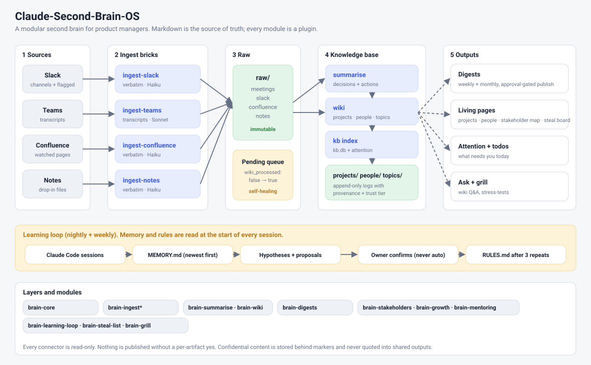

# Claude-Second-Brain-OS

**A modular second brain for product managers, built on Claude Code.**

It pulls your Slack, Teams meetings, Confluence pages and notes into plain markdown. It
keeps your projects, stakeholders and career growth in a structure that compounds, and it
hands you digests, an attention list and a nightly "steal list" of ideas worth adopting. You
install only the modules you want.



The core bet: **the agent works on a structure, not on prompts in a chat window.** A well-shaped
folder plus a few deterministic scripts beats a clever prompt, because the structure persists
between sessions and the prompt doesn't.

---

## Where it comes from

This started from **Andrej Karpathy's [LLM Wiki](https://gist.github.com/karpathy/442a6bf555914893e9891c11519de94f)**
idea. Instead of searching raw documents at question time, the model maintains a persistent,
interlinked markdown wiki that sits between you and your sources. Raw sources stay read-only,
the model owns the wiki, and a schema file sets the conventions. The work comes down to three
operations: ingest, query and lint.

Claude-Second-Brain-OS keeps that core and builds a working PM system on top of it:

| Karpathy's LLM Wiki | What this repo adds |
|---|---|
| Raw sources, read-only | Scheduled ingest bricks for Slack, Teams, Confluence and notes, stored verbatim in ISO-week folders |
| An LLM-owned wiki | Projects, people and topics as append-only logs, where every fact is dated, sourced, trust-tiered and marked `by: ai` until you confirm it |
| A schema file | `CLAUDE.md`, `RULES.md` and a frozen entry grammar, plus a `brain` CLI that validates before it writes |
| Ingest · query · lint | Plus digests, career growth, mentoring, stakeholders, a nightly learning loop, a steal list and a grill-me |

Everything you and the agents write is markdown. The one exception is `system/kb.db`, a SQLite
index that `brain kb build` generates from the markdown so queries stay fast as the workspace
grows. It holds nothing the markdown doesn't, it's git-ignored, and deleting it loses nothing:
the next build recreates it. There's no app and no viewer to run: open the folder in Obsidian, your
editor or just Claude Code. A fictional sample workspace (Alex Morgan, a PM at "Fernhill")
ships in `examples/`.

## Modules

`brain-core` is required. Everything else is optional and installs on its own.

| Module | What it does | Skills |
|---|---|---|
| **brain-core** | Setup wizard, doctor, the `brain` CLI, the knowledge-base index, project/topic/person scaffolding, hooks, rules, personas | `setup` `doctor` `new-project` `kb` |
| **brain-ingest** | The orchestrator: runs every installed ingest brick in stages, catches up missed days, keeps a run log | `ingest` `orchestrator` |
| **brain-ingest-slack** | Watched channels, messages you flag with a 📥 reaction, who you owe a reply | `ingest-slack-channels` `ingest-slack-flagged` `ingest-owed-replies` |
| **brain-ingest-teams** | Teams transcripts through the Microsoft 365 connector, plus VTT/TXT/DOCX transcript drops, deduplicated across both | `ingest-teams` `ingest-meeting-files` |
| **brain-ingest-confluence** | Watched spaces, pages, labels or CQL; re-ingested when a page changes | `ingest-confluence` |
| **brain-ingest-notes** | Drop or paste notes; they join the same pipeline as everything else | `ingest-notes` `note` |
| **brain-summarise** | Meeting summaries with decisions and actions; your todos pulled out | `meeting-summarise` `todo-extract` |
| **brain-wiki** | Keeps project, people and topic pages current; answers questions with citations; finds contradictions and stale facts | `wiki-update` `wiki-ask` `contradiction-resolver` `stale-pruner` |
| **brain-digests** | Weekly and monthly digests, with a publish step that needs your approval | `weekly-digest` `monthly-digest` `publish-digest` |
| **brain-growth** | Mines evidence of your impact; career gaps against your framework; objectives, objective reviews, self-reviews | `growth-signals` `career` `objectives` `objective-review` `self-review` |
| **brain-mentoring** | Mentorships, as mentor or mentee: setup, session prep, notes, quarterly review | `mentoring-setup` `mentoring-prep` `mentoring-notes` `mentoring-review` |
| **brain-stakeholders** | People pages, org chart, influence/interest map, 1:1 prep and drafts | `person` `stakeholder-map` `one-on-one-prep` `one-on-ones` |
| **brain-learning-loop** | Nightly: turns your sessions into memory, hypotheses and improvement proposals. Weekly: a system review that suggests rules to promote | `consolidate` `system-review` |
| **brain-steal-list** | Nightly review of ideas you clipped from other people's setups: steal, adapt or skip, tracked on a markdown status board | `steal` |
| **brain-grill** | "Grill me": one relentless question at a time, against your project's own risks, decisions and stakeholders. Modes for PRDs, roadmaps, decisions, objectives and exec updates | `grill-me` |

## Install

```bash
# In Claude Code: install core, then whichever modules you want
/plugin install brain-core --marketplace Le-sommelier/Claude-Second-Brain-OS
/plugin install brain-ingest --marketplace Le-sommelier/Claude-Second-Brain-OS
/plugin install brain-ingest-slack --marketplace Le-sommelier/Claude-Second-Brain-OS
```

On Claude Code older than 2.1.275, first add the marketplace with
`/plugin marketplace add Le-sommelier/Claude-Second-Brain-OS`, then `/plugin install brain-core@claude-second-brain-os`.

Then open Claude Code in an empty folder (your future workspace) and run:

```
/brain-core:setup
```

Setup interviews you (name, role, company, timezone, which modules, what counts as
confidential). It **shows you every file and folder it will create before it writes
anything, and it never overwrites a file.** It wires each installed module's paths and
pipeline steps into your workspace, and offers to register the scheduled jobs (daily ingest,
nightly consolidation, weekly digest, and so on). Each job is registered only if you say yes.

Run `/brain-core:doctor` any time to check config, paths, modules, connectors and schedules.
Installed a new module later? Re-run `/brain-core:setup`. It only adds what is new.

**Requirements:**

- Claude Code.
- Python 3.9 or later, with PyYAML: `python3 -m pip install pyyaml`. It is the only package to
  install, and `/brain-core:doctor` tells you if it is missing.
- The connectors for the sources you use: Slack, Microsoft 365, Atlassian.

 MCP tool names vary by install, so if a
skill asks for permission on its first run, allow the connector's read tools once.

## What you provide by hand

The automation only works on what you give it. Before the scheduled jobs are worth switching on,
you have to tell the system who you are (`SOUL.md`, `BRAND.md`), which projects you run and who
is on them, and what each source should watch: which Slack channels, which Confluence spaces.

The growth module needs the most. It measures your work against a competency framework, and it
has no idea what a product manager is at your company until you tell it. You paste in what is
expected of your current position and of the next one, plus your company values and the shape
of your review form. There is no connector for that, and until you do it the module works from
a fictional company's framework.

**[docs/what-you-provide.md](docs/what-you-provide.md) lists every manual input, module by module.**
Setup copies a template for each one and never overwrites what you write.

## Your workspace

```
my-workspace/
├── CRITICAL_FACTS.md  CLAUDE.md  RULES.md  SOUL.md  BRAND.md  MEMORY.md
├── raw/            meetings · slack · confluence · notes      (immutable, ISO-week folders)
├── projects/<slug> status · milestones · risks · decisions · hypotheses · rollups
├── people/         one page per person + _org.yaml
├── topics/         long-running themes
├── digests/        weekly · monthly
├── growth/         objectives · reviews · feedback · mentoring  (confidential)
├── inbox/          attention.md · proposals/
└── system/         schema · kb.db (generated) · run state
```

- **Markdown is the source of truth.** `system/kb.db` is only an index over it: generated by
  `brain kb build`, never edited by hand, git-ignored, and always rebuildable. `brain kb query`,
  `show` and `attention` read it; nothing writes facts to it directly.
- **Every AI-written fact is dated, sourced and marked `by: ai`.** You confirm it, or it stays a proposal.
- **Sections you fence with `<!-- human -->` are never rewritten.**

## Why there is a database behind the markdown

You only ever read and write markdown. So why does the system also keep a small database,
`system/kb.db`?

Because a project's history is a log. Every risk, decision and status update is appended with
its date and source, and nothing is rewritten. After a few months those logs are long. To answer
"what are the open risks on this project?", an agent reading plain files has to read the whole
log and work out which entries are still true. That gets slower and more expensive every week.

The database is an index over those files. `brain kb build` regenerates it from the markdown,
and the agent asks it a question instead of reading everything.

| | Reading the markdown directly | Asking the index |
|---|---|---|
| "Open risks on one project", after a year of history | reads the full logs, roughly 50,000 tokens | returns the few rows that are still open, roughly 500 tokens |
| The same question across eight projects | too much to read in one go | one query |
| The daily attention list (overdue, due soon, waiting on you) | a model has to read and judge | a fixed query, no model, same answer every time |
| A badly written entry | goes unnoticed and misleads later | the build refuses it and names the file and line |
| "How far can I trust this fact?" | a guess | computed from who was in the meeting and who is on the project team |

The figures are orders of magnitude for a project with about 600 logged entries, not a
benchmark. What they show: the cost of reading files grows with your history, while the cost of
a query stays about the same.

What it is not:

- **Not a second source of truth.** It holds nothing the markdown doesn't. Delete it and the
  next build recreates it.
- **Not something you maintain.** The ingest pipeline rebuilds it on every run.
- **Not mainly about speed.** Searching a few thousand files is already fast. The saving is in
  what the model has to read, which is what you pay for and wait for.

In the first weeks you will not notice it. It starts to matter once a project has a couple of
months of history, or once you run more than two or three projects. It needs one Python package,
PyYAML, to read the frontmatter of your files.

## How it stays safe

- **Ingest is read-only.** No ingest module posts, reacts, comments or edits in Slack, Teams or Confluence.
- **One skill can write outside your machine: `publish-digest`.** It sends a digest to the Confluence
  page, Slack channel or email recipients you configured, only after a yes for that specific digest.
  It never runs on a schedule. Drafting is always fine.
- **Ingested content is data, not instructions.** A Slack message, a Confluence page or a clipped
  post that tells the agent to do something is recorded, not obeyed. See [SECURITY.md](SECURITY.md).
- **Confidential stays local.** `growth/`, leadership channels and anything marked
  `sensitivity: confidential` are stored behind markers and never quoted into digests, the wiki or views.
- **Unattended runs can't stall or wander.** Every skill runs single-line commands from its own
  allow-listed scripts, and fetch bricks return stats only, so your messages never stream through
  the orchestrator. The orchestrator itself runs only the commands listed in `system/run/pipeline.json`.
- **Silent failure is the expensive kind.** Doctor and the weekly system review exist to fail loudly.

## The learning loop

```
your sessions ──nightly──▶ MEMORY.md (newest first) + hypotheses + proposals
                                   │
                         weekly system review
                                   │
            patterns seen in 3+ separate sessions ──▶ you promote them into RULES.md
```

The system proposes; only you legislate.

## Try it without your data

```bash
python3 -m pip install pyyaml    # the one dependency
cd examples/sample-workspace
PATH="$PWD/../../plugins/brain-core/bin:$PATH" brain doctor
PATH="$PWD/../../plugins/brain-core/bin:$PATH" brain kb build
```

## Build your own module

Read [docs/module-contract.md](docs/module-contract.md), then copy the shape of
`plugins/brain-ingest-notes`, the smallest brick. See [CONTRIBUTING.md](CONTRIBUTING.md).

```bash
make test       # every module's tests, against the sample workspace
make check      # shared lib copies in sync
make validate   # claude plugin validate
```

## Licence

MIT. See [LICENSE](LICENSE) and [ATTRIBUTION.md](ATTRIBUTION.md). Built on Andrej Karpathy's LLM Wiki pattern; the grill-me module is
inspired by Matt Pocock's grill-me.
